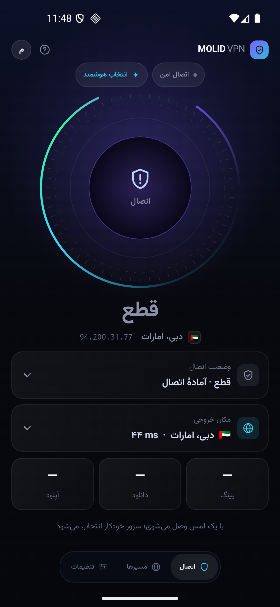
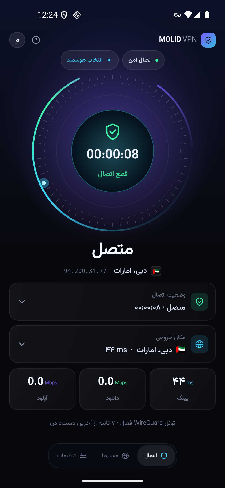
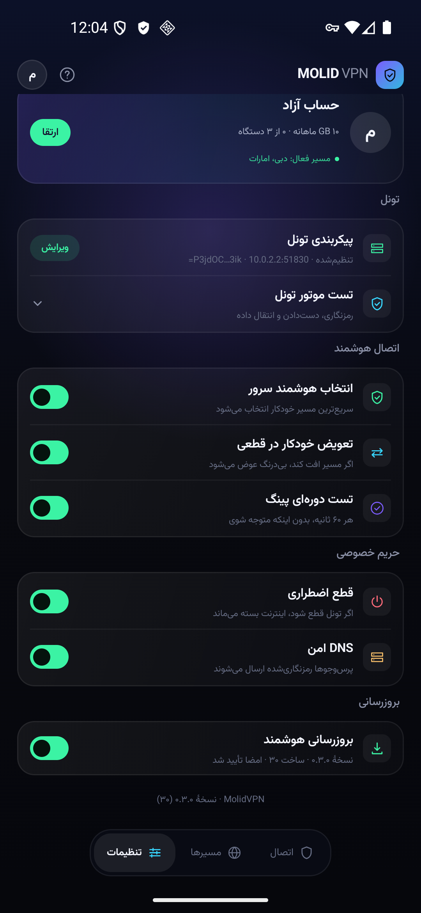

# MOLID VPN

کلاینت WireGuard برای اندروید با کاتلین و Jetpack Compose — تونل واقعی، بدون کتابخانهٔ بومی.

[](https://github.com/hidooch980/MolidVPN/releases/latest)

| خانه | متصل | تنظیمات |
| --- | --- | --- |
|  |  |  |

## امکانات

- **تونل واقعی WireGuard**: Noise\_IKpsk2\_25519\_ChaChaPoly\_BLAKE2s در کاتلین خالص (BouncyCastle)، روی TUN با MTU ۱۴۲۰.
- **صفحهٔ اصلی مدار/راکتور**: حلقهٔ وضعیت، تایمر، دکمهٔ وسط، کارت وضعیت، خروجی‌ها و متریک آپلود/دانلود/پینگ.
- **چیدمان قابل ویرایش**: ترتیب، نمایش، فاصله و مقیاس بخش‌ها از `app/src/main/assets/home_layout.json` خوانده می‌شود؛ استودیو در `design/home-layout-studio.html` و بازگردانی با `build.ps1 -Reset`.
- **انتخاب هوشمند مسیر**: پینگ خودکار، سریع‌ترین مسیر، تعویض خودکار در قطعی، تست دوره‌ای پینگ.
- **حریم خصوصی**: قطع اضطراری، DNS امن، شمارندهٔ داده.
- **بروزرسانی هوشمند**: بررسی مانیفست، تطبیق SHA-256 و امضا پیش از نصب.
- **رابط RTL** با اعداد فارسی و بیدی جداشده برای متن لاتین.

## نصب

از [Releases](https://github.com/hidooch980/MolidVPN/releases/latest) فایل APK را بگیر و نصب کن. اندروید ۸٫۰ (API 26) و بالاتر.

## ساخت

```bash
./gradlew :app:assembleDebug      # نسخهٔ دیباگ
./gradlew :app:assembleRelease    # نسخهٔ ریلیز (نیازمند keystore.properties)
```

برای امضای ریلیز، `keystore.properties.example` را به `keystore.properties` کپی کن و مقادیر کلید خودت را بگذار. این فایل و `*.jks` در گیت نادیده گرفته می‌شوند.

## پیکربندی

- سرورها و مسیرها درون‌برنامه‌اند؛ پیکربندی واقعی تونل (کلید خصوصی، همتا، اندپوینت، AllowedIPs) از **تنظیمات ← پیکربندی تونل** وارد می‌شود.
- مانیفست بروزرسانی: `release/update.json` و آدرس آن در `app/src/main/java/com/molidvpn/update/Updater.kt`.
- چیدمان صفحهٔ اصلی: `app/src/main/assets/home_layout.json`.

## وضعیت

- نسخهٔ ۰.۳.۰ با پیاده‌سازی مرجع wireguard-go تست دست‌دادن (handshake) شده است.
- مخزن هیچ کلید امضا یا رمز عبوری ندارد.

## لایسنس

بدون لایسنس تعیین‌شده؛ استفاده از کد با اجازهٔ نویسنده.
